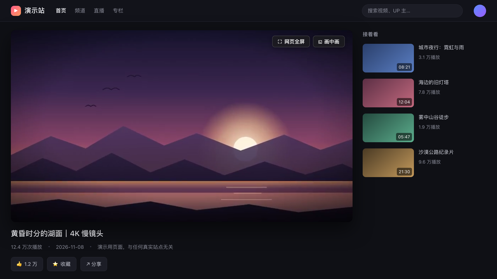
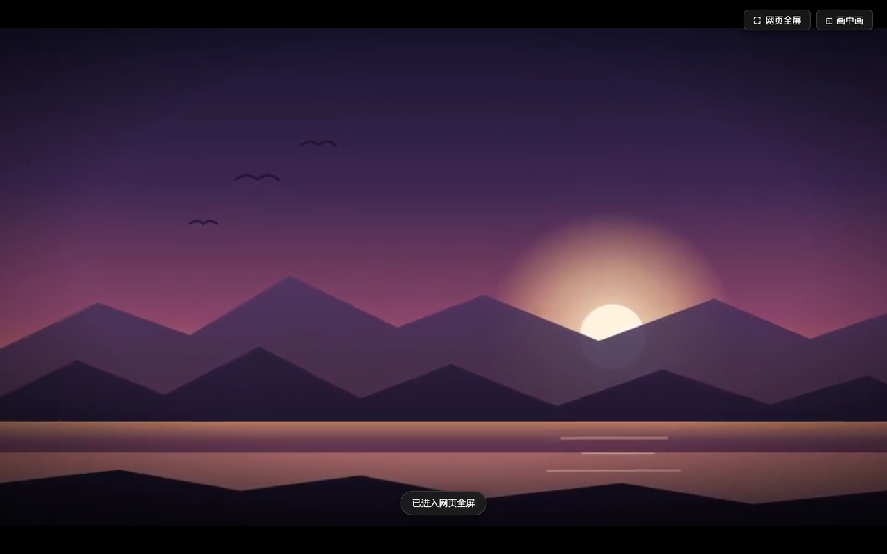
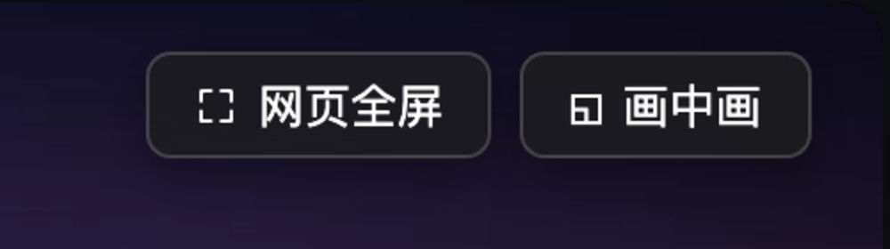

<div align="center">

# 🎬 视频网页全屏 / 画中画

**一个 Tampermonkey 用户脚本：按 `Esc` 让视频铺满窗口，按 `F2` 塞进画中画。**

[](Video-Fullscreen.user.js)
[](https://www.tampermonkey.net/)
[](#-先找官方按钮没有再自己动手)
[](LICENSE)

**[⬇️ 安装](https://raw.githubusercontent.com/hulatu/Video-Fullscreen/main/Video-Fullscreen.user.js)** ・
**[⚡ 两个键](#-两个键)** ・
**[🎛 想微调](#-想微调)** ・
**[🚧 注意](#-注意)**

</div>



## 📑 目录

| 想了解 | 看这里 |
| --- | --- |
| 它解决什么问题 | [🎯 一句话](#-一句话) |
| 有哪些快捷键 | [⚡ 两个键](#-两个键) |
| 为什么有的站点更好用 | [🥇 先找官方按钮，没有再自己动手](#-先找官方按钮没有再自己动手) |
| 不想按键盘 | [🖱 不按键盘也行](#-不按键盘也行) |
| 会不会跟站点打架 | [🛡 不添乱](#-不添乱) |
| 怎么装 | [🚀 装法](#-装法) |
| 想自己调 | [🎛 想微调](#-想微调) |
| 坏了 / 不生效 | [🚧 注意](#-注意) |

## 🎯 一句话

「网页全屏」这个按钮，在大多数视频站上都藏在播放器右下角的控制条里：先把鼠标移进去、等控制条浮出来、再点那个小小的图标。有些站干脆没有这个按钮，只有「全屏」（会真的接管整个屏幕，切换窗口就得退出）。

这个脚本把这件事变成一个键：**`Esc`**。

- 站点有官方网页全屏按钮 → 直接帮你点它（B 站、YouTube、斗鱼、虎牙、腾讯视频、爱奇艺）
- 没有 → 用 CSS 把 `<video>` 撑满视口，页面其余部分让开

再送你一个 `F2` 进画中画，和一个鼠标移上去就浮出来的按钮条。

## ⚡ 两个键

| 按键 | 做什么 | 什么时候不接管 |
| --- | --- | --- |
| `Esc` | 网页全屏 / 退出 | 光标在输入框里・已经在系统全屏・页面上没有像样的视频 |
| `F2` | 画中画 / 退出 | 光标在输入框里・页面上没有像样的视频 |

两个键都是「先判断自己该不该管，再决定要不要拦」。判断结果是「不该管」时，脚本**什么都不做**，按键原样交给站点 —— 不会出现「我按 Esc 想关弹幕输入框，结果视频全屏了」。

## 🥇 先找官方按钮，没有再自己动手

| 站点 | 点的哪个按钮 | 备注 |
| --- | --- | --- |
| bilibili.com | `.bpx-player-ctrl-web`<br>`.squirtle-video-pagefullscreen`<br>`.bilibili-live-player-video-controller-web-fullscreen-btn-span` | 普通视频 / 番剧 / 直播 三种播放器各有一套 |
| youtube.com | `.ytp-size-button` | 影院模式 |
| douyu.com | `div[title="网页全屏"]`<br>`.layout-Player-toolbar-webFull` | |
| huya.com | `.player-fullpage-btn` | |
| v.qq.com | `.txp_btn_fake` | |
| iqiyi.com | `.iqp-btn-webscreen` | |
| 其余所有站点 | —— | 走 CSS 兜底 |

**为什么优先点官方按钮**：那是站点自己实现的全屏，弹幕层、控制条、弹幕输入框、播放进度都由它自己摆好，比自己拿 CSS 撑大可靠得多。CSS 兜底只是「这站没有官方按钮」时的备胎。

兜底做的事只有四行：`<video>` 变成 `position: fixed` + `100vw × 100vh` + `object-fit: contain`，祖先链清掉 `transform`（很多站的播放器被包在 `transform` 容器里，不清掉 `fixed` 会失效），再锁住 `body` 滚动。按 `Esc` 原样退回。



## 🖱 不按键盘也行

鼠标停在视频上，右上角会浮出两个磨砂玻璃按钮，停手 2.5 秒自动收起。



- 按钮放在 **Shadow DOM** 里，站点再激进的 `button { ... }` 也影响不到它，反过来它也不会污染站点样式
- 鼠标移到按钮条上会重新计时，不会在你要点的瞬间消失
- 画中画开着的时候，按钮文案会变成「退出画中画」

## 🛡 不添乱

这类「接管全局按键」的脚本最容易招人烦，所以 2.1 把大部分功夫花在「什么时候不管」上：

| 情况 | 脚本的反应 |
| --- | --- |
| 页面上没有视频 | **一个 DOM 节点都不插**，样式也不插 |
| 视频太小（不到视口 15%，或任一边不足 150px） | 当作没有视频，`Esc` 不拦、按钮不浮 |
| 光标在 `<input>` / `<textarea>` / `contenteditable` 里 | 完全不插手：不失焦、不拦按键（写评论时按 `Esc` 想取消，就该取消） |
| 已经在系统全屏（`F11` 或原生全屏） | 交给浏览器自己退，脚本不抢 |
| 按了 `Esc` 但判断不该管 | 不 `preventDefault`、不 `stopPropagation`，站点照常收到 |

另外两个小决定：

- `z-index` 用 `2147483000` 而不是 `2147483647` —— 留一格给站点自己的弹层，不至于被按钮条盖住
- 「视频够不够大」只有**一把尺子**（`bigEnough()`），按钮浮出、`Esc`、画中画三处共用。早期版本这里各写各的，会出现「按钮出来了但按 `Esc` 没反应」的自相矛盾

## 🚀 装法

1. 装 [Tampermonkey](https://www.tampermonkey.net/)（Chrome / Edge / Firefox 商店都有；Safari 用 [Userscripts](https://apps.apple.com/app/userscripts/id1463298887)）。
2. 点 **[Video-Fullscreen.user.js](https://raw.githubusercontent.com/hulatu/Video-Fullscreen/main/Video-Fullscreen.user.js)** —— 会弹出安装页，点「安装」。
3. 随便打开一个视频，按 `Esc`。

> 脚本头里写了 `@updateURL` / `@downloadURL`，以后我推新版本，Tampermonkey 会自己提示更新。

装不上就手动来：Tampermonkey 面板 → 添加新脚本 → 把 `.user.js` 全文粘进去替换模板 → `Cmd/Ctrl + S`。

## 🎛 想微调

脚本开头有一个 `CFG`：

```js
const CFG = {
  uiHideDelay:  2500,   // 鼠标离开视频后多久收起按钮（ms）
  minVideoArea: 0.15,   // 视频至少要占视口 15% 才认作「在看视频」
  minVideoSide: 150,    // 视频任一边小于这个值就不算（px）
  zIndex:       2147483000
};
```

几个常见的改法：

- **按钮条太容易消失**：`uiHideDelay: 5000`
- **小窗口 / 分屏下 `Esc` 不生效**：说明视频没到视口 15%，把 `minVideoArea` 调到 `0.08`
- **怕误伤页面上的小广告视频**：把 `minVideoArea` 提到 `0.3`
- **按钮条挡住了站点自己的控件**：`zIndex` 调低一档

**想加一个站点**（等站点改版换了类名也一样）：在 `siteRules` 里加一行就行，`host` 用 `includes` 匹配，`webBtn` 可以是逗号分隔的多个选择器：

```js
{ host: 'example.com', webBtn: '.player-btn-webscreen' },
```

加完不用重启浏览器，Tampermonkey 里保存即生效。

## 🚧 注意

- **只管 `<video>`**：iframe 里的播放器抓不到（脚本带了 `@noframes`，不在每个 iframe 里跑），所以「嵌在别的页面里的 YouTube」这类场景不生效。
- **兜底全屏是 CSS，不是真全屏**：浏览器地址栏还在，按 `F11` 才是真全屏。好处是切换窗口不会被退出。
- **画中画可能被拒**：DRM 视频（Netflix 之类）、跨域视频、或者站点写了 `disablePictureInPicture` 的，浏览器会直接拒绝，脚本会提示「进入画中画失败：NotAllowedError」或「这个视频不支持画中画」。
- **站点改版会失效**：`siteRules` 里的选择器一变，那个站点就退化成 CSS 兜底（仍然可用，只是没官方按钮那么完美）。改选择器即可。
- **不联网、不读内容**：脚本不发起任何请求，只找 `<video>`、算尺寸、点按钮。

## 🧪 兼容性

在 Chrome（Helium 157）+ Tampermonkey 下开发。2.1 用一个本地演示页 + CDP 跑了 8 组行为断言，全部通过：

```
1. 没有视频的页面：Esc 不被拦、一个节点都没插        ✓
2. 有视频、无官方按钮：Esc 走 CSS 兜底，再按退出      ✓
3. 有官方按钮：Esc 点按钮，不走 CSS 兜底              ✓
4. 鼠标移到视频上：按钮条浮出、定位正确               ✓
5. 点按钮条上的「网页全屏」：进入兜底全屏             ✓
6. 输入框里按 Esc：焦点不动、不触发全屏               ✓
7. 鼠标停在按钮条上：自动收起计时被推迟               ✓
8. 页面上只有小视频：不浮按钮、Esc 也不拦             ✓
```

用到的都是 2018 年以后就稳定的东西（Shadow DOM、`composedPath()`、`aspect-ratio` 之外的基本 CSS），Chrome 90+ / Firefox 90+ / Safari 15+ 都没问题。

<details>
<summary><b>🔧 2.1 相对 1.x 改了什么</b></summary>

| 项 | 1.x | 2.1 |
| --- | --- | --- |
| 元数据 | `@exclude` / `@grant` / `@run-at` 各写了两遍 | 去重，补 `@license` `@noframes` `@updateURL` |
| 注入 | 每个页面都塞 UI 和样式 | 用到才塞；没视频的页面零注入 |
| UI 样式 | 整页 CSS，容易被站点样式污染 | Shadow DOM + `:host { all: initial }` |
| 输入框里的 `Esc` | `blur` 掉输入框再吞掉按键 | 完全不插手（以前写评论会莫名丢焦点） |
| 鼠标移动 | 每次 `mousemove` 都读 `offsetWidth`，强制重排 | 节流 80ms + 缓存宽度 |
| 视频判定 | 各分支各写一套 | 统一 `bigEnough()` |
| 兜底全屏 | `object-fit` 只写在 `video` 后代上，`<video>` 自己全屏时会被拉变形 | 直接写在 `.mv-fallback-fs` 上，16:9 进 16:10 不再纵向拉伸 |
| `z-index` | `2147483647` | `2147483000`，给站点弹层留一格 |
| 按钮条 | 只在视频上浮出，移到按钮上就消失 | 移到按钮上会续命 |
| 画中画文案 | 不随状态变 | 进出画中画自动改文案 |
| 控制台 | 每次注入都 `console.warn` | 静默 |

</details>

## 📄 许可

[MIT](LICENSE) —— 随便改、随便用，出问题别找我。

> 最早是照着 [视频网页全屏](https://greasyfork.org/zh-CN/scripts/4870-maximize-video) 的思路改的，2.1 基本重写了一遍。
